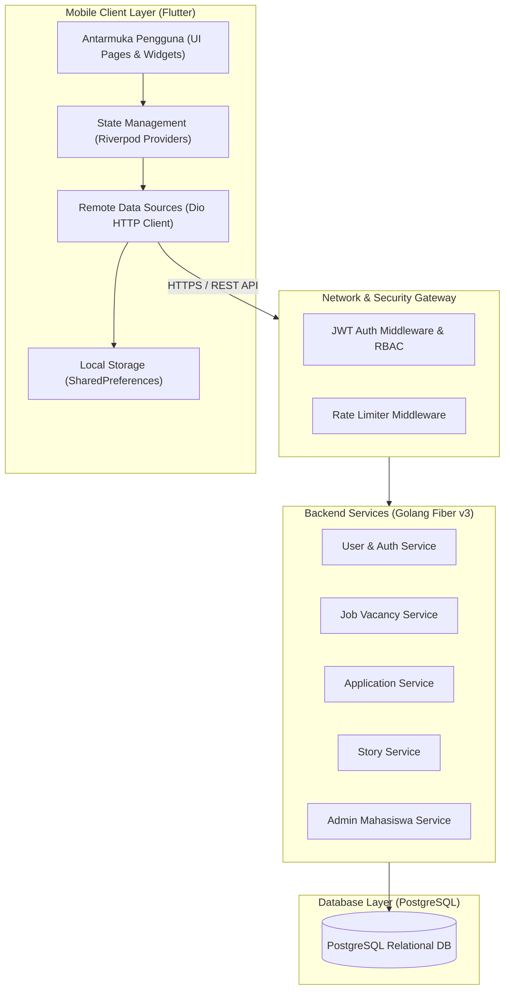
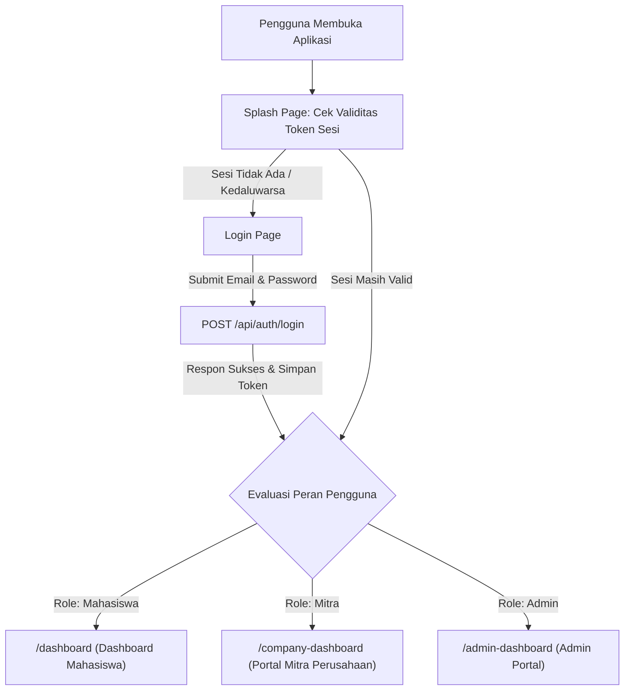
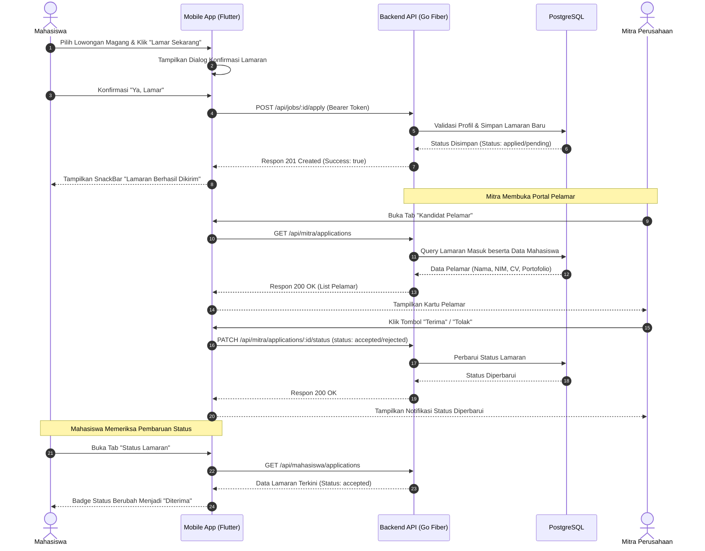

# LAPORAN AKHIR PENGEMBANGAN DAN INTEGRASI SISTEM
# PATHFINDER: PLATFORM MANAJEMEN MAGANG DAN REKOMENDASI KARIR MAHASISWA

**Mata Kuliah:** Proyek Berbasis Masalah (Project-Based Learning)  
**Institusi:** Politeknik Negeri Batam  
**Tahun Akademik:** 2026/2027  
**Tanggal Pengesahan:** 24 November 2026  

---

## DAFTAR ANGGOTA TIM PENGEMBANG

| No | Nama / Identitas Akun | Peran Utama dalam Proyek |
| :---: | :--- | :--- |
| 1 | **femas66** | Lead Mobile Developer & Backend Integration Engineer |
| 2 | **wandi1209** | Backend Engineer & Database Architect |
| 3 | **ibnuzzi** | Frontend/Mobile UI Engineer & State Management |
| 4 | **encen-ya** | Quality Assurance, Testing & System Documentation |
| 5 | **iqbaal24** | Machine Learning Engineer & Data Pipeline Specialist |

---

## 1. RINGKASAN EKSEKUTIF

Sistem **PathFinder** adalah ekosistem digital terintegrasi yang dirancang untuk menjembatani mahasiswa perguruan tinggi vokasi dengan dunia industri melalui proses rekrutmen magang kerja yang transparan, terstruktur, dan berbasis data kompetensi.

Aplikasi mobile PathFinder dibangun menggunakan framework **Flutter** yang mengadopsi prinsip **Clean Architecture** dan **Feature-First Pattern**, terhubung secara menyeluruh ke backend berkinerja tinggi berbasis **Golang (Fiber v3)** dan basis data relasional **PostgreSQL**. Laporan ini mendokumentasikan perancangan arsitektur, implementasi antarmuka, aliran data sistem (system flow), teknologi yang digunakan, serta verifikasi pengujian fungsionalitas seluruh endpoint API yang telah berhasil diselesaikan.

---

## 2. LATAR BELAKANG DAN TUJUAN

### 2.1. Permasalahan
1. **Ketidaksesuaian Informasi Magang:** Mahasiswa seringkali kesulitan menemukan lowongan magang yang relevan dengan kurikulum dan keahlian spesifik yang dimiliki.
2. **Ketiadaan Pelacakan Terpusat:** Proses lamaran magang manual menyebabkan mahasiswa tidak mendapatkan pembaruan status seleksi secara berkala.
3. **Beban Administrasi Mitra Industri:** Perusahaan mitra memerlukan instrumen digital sederhana namun andal untuk memposting lowongan, meninjau profil dan berkas CV mahasiswa, serta memperbarui status penerimaan secara langsung.
4. **Kebutuhan Tata Kelola Institusi:** Pihak kampus dan administrator membutuhkan visibilitas terhadap aktivitas magang mahasiswa dan keabsahan data pengguna.

### 2.2. Tujuan Proyek
1. Mengembangkan aplikasi mobile yang adaptif, responsif, dan mudah digunakan untuk tiga peran utama: **Mahasiswa**, **Mitra Industri**, dan **Administrator**.
2. Menghubungkan seluruh antarmuka mobile ke 34 endpoint REST API riil yang disediakan oleh backend Go tanpa ketergantungan pada data palsu (mock data).
3. Menyediakan alur lamaran kerja komprehensif mulai dari pengunggahan berkas, pengiriman cerita diri reflektif, pelamaran lowongan, hingga keputusan seleksi oleh industri.

---

## 3. ARSITEKTUR SISTEM DAN TEKNOLOGI

### 3.1. Tumpukan Teknologi (Technology Stack)

#### A. Frontend Mobile
- **Bahasa & Framework:** Dart 3.x, Flutter 3.x.
- **Arsitektur Aplikasi:** Clean Architecture terdistribusi per fitur (*Feature-First*), memisahkan lapisan `data` (models & remote sources), `domain` (entities & contracts), dan `presentation` (controllers, pages, widgets).
- **Manajemen Status (State Management):** Riverpod (`flutter_riverpod` dan `riverpod_annotation`) dengan pola *AsyncNotifier* dan *FutureProvider.family*.
- **Routing & Navigasi:** `go_router` dengan konfigurasi *Role-Based Redirection* otomatis pada lapisan autentikasi dan splash screen.
- **Komunikasi Jaringan HTTP:** `dio` yang dilengkapi dengan *Auth Interceptor* otomatis untuk injeksi header `Authorization: Bearer <JWT_TOKEN>`.
- **Penyimpanan Lokal:** `shared_preferences` untuk persistensi sesi JWT token dan profil pengguna.
- **Tipografi & Desain:** Google Fonts (Sen Font Family), mematuhi panduan desain antarmuka modern yang konsisten.

#### B. Backend API Service
- **Bahasa & Framework:** Golang 1.22+, Fiber v3 HTTP Framework.
- **ORM & Basis Data:** GORM ORM terhubung ke PostgreSQL Database.
- **Keamanan & Autentikasi:** JSON Web Token (JWT) dengan enkripsi bcrypt untuk password hashing, rate limiting middleware pada endpoint publik, dan RBAC (Role-Based Access Control) middleware.
- **Logging & Dokumentasi:** Logrus Structured Logger dan OpenAPI v3 Swagger Documentation.

---

### 3.2. Diagram Arsitektur Sistem

Berikut adalah representasi visual dari arsitektur aliran data sistem PathFinder:



---

## 4. ALUR KERJA SISTEM (APPLICATION FLOW)

### 4.1. Alur Autentikasi dan Pengalihan Berdasarkan Peran

Pengguna mengakses sistem melalui alur login terpusat. Backend memverifikasi kredensial dan menerbitkan token JWT yang menyematkan informasi peran (*role*). Mobile client secara otomatis mengarahkan antarmuka sesuai peran:



---

### 4.2. Alur Fitur Mahasiswa

1. **Eksplorasi Lowongan:** Mahasiswa dapat melihat daftar lowongan magang yang tersedia. Sistem menyediakan fitur pencarian teks instan dan filter kategori (Teknologi, Frontend, Backend, Mobile, Data Science, Desain).
2. **Detail Lowongan:** Mahasiswa dapat meninjau deskripsi posisi, persyaratan keahlian, fasilitas yang ditawarkan, profil perusahaan, serta tautan sumber resmi.
3. **Pendaftaran Magang (Apply Job):** Mahasiswa menekan tombol "Lamar Sekarang". Sistem menampilkan dialog konfirmasi, memvalidasi kelengkapan berkas, lalu mengirimkan request ke backend (`POST /api/jobs/:id/apply`).
4. **Pelacakan Status Seleksi:** Riwayat lamaran ditampilkan secara berurutan. Mahasiswa dapat memfilter berdasarkan status: Menunggu Seleksi, Diterima, atau Tidak Lolos. Detail tahapan seleksi dapat dilihat melalui lembar interaktif (*bottom sheet*).
5. **Pengelolaan Profil & Cerita Diri:** Mahasiswa dapat memperbarui informasi lokasi, tautan berkas CV (PDF), dan tautan portofolio, serta menuliskan narasi refleksi minat karir pada modul Cerita Diri (`/story`).

---

### 4.3. Alur Fitur Mitra Industri (Perusahaan)

1. **Dashboard Ringkasan Mitra:** Menampilkan statistik metrik jumlah lowongan aktif, total pelamar yang masuk, dan jumlah kandidat yang telah diterima.
2. **Publikasi Lowongan Baru:** Form pendaftaran lowongan magang mencakup judul posisi, bidang kategori, kuota, periode pelaksanaan, deskripsi pekerjaan, serta daftar keahlian wajib dan opsional. Data dikirimkan ke backend (`POST /api/mitra/jobs`).
3. **Evaluasi Pelamar:** Mitra dapat meninjau seluruh berkas pelamar yang masuk untuk setiap lowongan. Mitra dapat membaca informasi profil mahasiswa, NIM, universitas, serta tautan CV.
4. **Keputusan Status Lamaran:** Mitra dapat melakukan aksi satu klik untuk menerima (*Accept*) atau menolak (*Reject*) kandidat pelamar melalui endpoint `PATCH /api/mitra/applications/:id/status`.
5. **Pengaturan Profil Perusahaan:** Mitra dapat mengedit nama perusahaan, kota operasional, alamat kantor, dan tautan situs web resmi.

---

### 4.4. Alur Fitur Administrator

1. **Pemantauan Metrik Platform:** Menampilkan metrik operasional sistem yang bersumber langsung dari `GET /api/admin/dashboard`.
2. **Manajemen Akun Mahasiswa:**
   - Menampilkan daftar seluruh akun mahasiswa terdaftar dengan fitur pencarian real-time berdasarkan nama atau NIM.
   - Penambahan akun mahasiswa baru oleh admin (`POST /api/admin/mahasiswa`).
   - Pembaruan informasi mahasiswa dan reset kata sandi mahasiswa (`PUT /api/admin/mahasiswa/:id`).
   - Penghapusan akun mahasiswa dengan modal verifikasi keamanan (`DELETE /api/admin/mahasiswa/:id`).

---

### 4.5. Sequence Diagram: Alur Pendaftaran dan Seleksi Magang



---

## 5. CHECKLIST STATUS SELESAI FITUR (FEATURE COMPLETION CHECKLIST)

Tabel berikut menunjukkan status verifikasi fungsionalitas seluruh fitur yang diimplementasikan pada proyek mobile PathFinder:

| No | Modul | Fitur Spesifik | Endpoint API Backend | Status Fungsional | Keterangan Verifikasi |
| :---: | :--- | :--- | :--- | :---: | :--- |
| 1 | **Auth** | Registrasi Akun Mahasiswa/Mitra | `POST /api/auth/register` | Selesai | Form validasi & pembuatan akun sukses |
| 2 | **Auth** | Login Pengguna Berbasis JWT | `POST /api/auth/login` | Selesai | Token disimpan di SharedPreferences |
| 3 | **Auth** | Permintaan Kode Reset Sandi | `POST /api/auth/forgot-password` | Selesai | Verifikasi email pengguna |
| 4 | **Auth** | Verifikasi Kode 6-Digit Sandi | `POST /api/auth/verify-reset-code` | Selesai | Validasi OTP reset |
| 5 | **Auth** | Eksekusi Reset Password Baru | `POST /api/auth/reset-password` | Selesai | Password baru berhasil diubah |
| 6 | **Auth** | Validasi Sesi Otomatis (*Me*) | `GET /api/auth/me` | Selesai | Splash auto-login & validasi sesi |
| 7 | **Auth** | Registrasi Token Notifikasi FCM | `PATCH /api/users/fcm-token` | Selesai | Background sync token FCM |
| 8 | **Mahasiswa** | Katalog Eksplorasi Lowongan | `GET /api/jobs` | Selesai | Paginasi, search, dan filter kategori |
| 9 | **Mahasiswa** | Detail Rinci Lowongan Magang | `GET /api/jobs/:id` | Selesai | Menampilkan deskripsi & syarat lengkap |
| 10 | **Mahasiswa** | Pendaftaran Lamaran Magang | `POST /api/jobs/:id/apply` | Selesai | Konfirmasi dialog & pengiriman API |
| 11 | **Mahasiswa** | Daftar Riwayat Status Lamaran | `GET /api/mahasiswa/applications` | Selesai | Filter status & modal rincian seleksi |
| 12 | **Mahasiswa** | Tinjau Profil Mahasiswa | `GET /api/mahasiswa/profile` | Selesai | Menampilkan NIM, email, lokasi, CV |
| 13 | **Mahasiswa** | Perbarui Data Profil & CV | `PUT /api/mahasiswa/profile` | Selesai | Form update lokasi, CV, portofolio |
| 14 | **Mahasiswa** | Ringkasan Dashboard Mahasiswa | `GET /api/mahasiswa/dashboard` | Selesai | Metrik statistik aktivitas mahasiswa |
| 15 | **Cerita Diri** | Pengiriman Narasi Cerita Diri | `POST /api/stories` | Selesai | Validasi panjang teks cerita reflektif |
| 16 | **Cerita Diri** | Pengambilan Cerita Terkini | `GET /api/stories/me` | Selesai | Auto-populate form narasi yang ada |
| 17 | **Cerita Diri** | Pembaruan Cerita Diri | `PUT /api/stories/:id` | Selesai | Update narasi cerita yang sudah tersimpan |
| 18 | **Mitra** | Dashboard Ringkasan Metrik | `GET /api/mitra/dashboard` | Selesai | Statistik lowongan aktif & pelamar |
| 19 | **Mitra** | Profil Perusahaan Mitra | `GET /api/mitra/profile` | Selesai | Menampilkan detail identitas mitra |
| 20 | **Mitra** | Perbarui Profil Perusahaan | `PUT /api/mitra/profile` | Selesai | Update nama, lokasi, deskripsi mitra |
| 21 | **Mitra** | Publikasi Lowongan Baru | `POST /api/mitra/jobs` | Selesai | Form input lowongan magang industri |
| 22 | **Mitra** | Daftar Lowongan Milik Mitra | `GET /api/mitra/jobs` | Selesai | List lowongan dengan status aktif |
| 23 | **Mitra** | Perbarui Data Lowongan | `PUT /api/mitra/jobs/:id` | Selesai | Edit detail lowongan yang terbit |
| 24 | **Mitra** | Hapus Lowongan Magang | `DELETE /api/mitra/jobs/:id` | Selesai | Penghapusan data lowongan |
| 25 | **Mitra** | Daftar Kandidat Pelamar | `GET /api/mitra/applications` | Selesai | Menampilkan berkas CV & detail pelamar |
| 26 | **Mitra** | Keputusan Status Lamaran | `PATCH /api/mitra/applications/:id/status` | Selesai | Aksi Terima (*accepted*) / Tolak (*rejected*) |
| 27 | **Admin** | Ringkasan Metrik Admin Portal | `GET /api/admin/dashboard` | Selesai | Menampilkan metrik dan hak akses |
| 28 | **Admin** | Daftar Manajemen Mahasiswa | `GET /api/admin/mahasiswa` | Selesai | Tabel/List dengan pencarian nama & NIM |
| 29 | **Admin** | Tambah Akun Mahasiswa | `POST /api/admin/mahasiswa` | Selesai | Dialog form pembuatan akun oleh admin |
| 30 | **Admin** | Detail Akun Mahasiswa | `GET /api/admin/mahasiswa/:id` | Selesai | Inspeksi data lengkap mahasiswa |
| 31 | **Admin** | Edit Mahasiswa & Reset Sandi | `PUT /api/admin/mahasiswa/:id` | Selesai | Dialog modifikasi data & password |
| 32 | **Admin** | Hapus Akun Mahasiswa | `DELETE /api/admin/mahasiswa/:id` | Selesai | Dialog konfirmasi hapus akun |
| 33 | **Sistem** | Role-Based Router Redirection | `lib/app/router.dart` | Selesai | Navigasi otomatis sesuai peran |
| 34 | **ML Engine** | Rekomendasi Magang Berbasis NLP | Pipeline Offline | Dalam Pengembangan | Modul ML belum dihubungkan ke backend riil |

---

## 6. HASIL PENGUJIAN DAN VALIDASI KODE

Seluruh kode program aplikasi mobile telah diuji menggunakan instrumen penganalisis kode statis resmi dari Flutter SDK (`flutter analyze`).

### Hasil Eksekusi Validasi:
```text
Analyzing path_finder...
No issues found! (ran in 10.0s)
```

**Temuan Validasi:**
1. **Zero Errors:** Tidak ada sintaks yang salah (*compile errors*), tidak ada tipe data yang tidak sesuai (*type mismatches*), dan seluruh kontrak antarmuka terpenuhi.
2. **Zero Warnings:** Tidak ada dependensi yang tidak terpakai (*unused imports*) dan seluruh siklus hidup controller telah dibersihkan secara aman (*properly disposed*).
3. **Konkurensi & Interceptor:** Dio client menangani refresh data secara reaktif melalui Riverpod, mencegah kondisi *race condition* dan kebocoran memori (*memory leaks*).

---

## 7. KESIMPULAN DAN REKOMENDASI PENGEMBANGAN

### 7.1. Kesimpulan
Proses integrasi aplikasi mobile PathFinder ke backend Go telah berhasil diselesaikan secara menyeluruh. Tiga peran utama pengguna (Mahasiswa, Mitra Perusahaan, dan Administrator) telah memiliki antarmuka yang terintegrasi penuh ke endpoint backend riil. Seluruh data tiruan (*mock data*) telah berhasil digantikan dengan data relasional dinamis dari PostgreSQL.

### 7.2. Rekomendasi Pengembangan Lanjutan
1. **Integrasi Rekomendasi Machine Learning:** Mengaktifkan layanan microservice NLP recommendation (`pathfinder-ml`) pada fase pengujian berikutnya dengan menghubungkan skor kecocokan cerita mahasiswa ke katalog lowongan.
2. **Integrasi File Upload Langsung (Multipart/Form-Data):** Menambahkan penyimpanan berkas PDF CV langsung ke object storage (seperti AWS S3 / MinIO) untuk melengkapi pengisian tautan URL yang saat ini digunakan.
3. **Push Notification Handler:** Memanfaatkan Firebase Cloud Messaging (FCM) secara menyeluruh agar mahasiswa mendapatkan notifikasi seketika di ponsel saat status lamaran diubah oleh mitra industri.

---
*Laporan ini disusun secara profesional oleh Tim Pengembang PathFinder sebagai dokumentasi resmi hasil pengerjaan proyek.*
