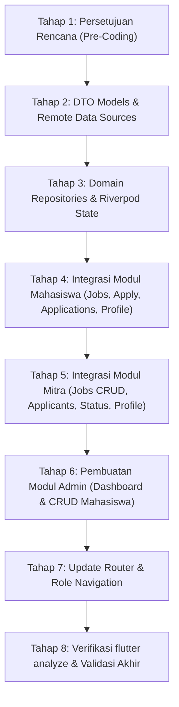

# Rencana Integrasi Komprehensif Mobile Flutter ke Backend Go
**Proyek:** PathFinder Mobile (`path_finder`) & PathFinder Backend (`path-finder-backend`)  
**Tanggal:** 24 November 2026  
**Status:** Draf Perencanaan Arsitektur & Implementasi (Pre-Coding)

---

## 1. Ringkasan Eksekutif & Batasan Proyek

Dokumen ini memetakan seluruh arsitektur, strategi teknis, pemetaan endpoint, struktur data transfer objects (DTO), dependensi Riverpod, hingga rancangan UI antarmuka untuk menghubungkan aplikasi mobile Flutter (`path_finder`) ke seluruh endpoint REST API riil backend Go (`path-finder-backend`).

### Batasan Utama Sesuai Instruksi Pengguna:
1. **Machine Learning Diabaikan (No ML)**: Tidak menyentuh atau memanggil pipeline Machine Learning (`pathfinder-ml`). Seluruh tampilan rekomendasi berbasis AI tetap berada pada kondisi statis/placeholder atau graceful fallback.
2. **Git Safeguard**: **TIDAK melakukan commit atau push ke Git** dalam tahap ini.
3. **Penyusunan Perencanaan Tertulis**: Pembuatan dokumen markdown ini wajib diselesaikan dan dipaparkan sebelum implementasi kode dimulai.
4. **Cakupan 100% Endpoint Backend**: Seluruh fungsionalitas backend Go (Mahasiswa, Mitra/Perusahaan, Admin, Lowongan, Lamaran, Profil, Cerita Diri) harus dapat dioperasikan penuh melalui aplikasi Flutter.

---

## 2. Pemetaan Lengkap Endpoint Backend Go ke Mobile Flutter

Seluruh komunikasi HTTP menggunakan protokol JSON dengan standard response envelope `WebResponse<T>`:
- **Base URL**: `http://10.0.2.2:3000` (Android Emulator) / `http://127.0.0.1:3000` (iOS Simulator) / Custom `--dart-define=BASE_URL=...`
- **Header Autentikasi**: `Authorization: Bearer <JWT_TOKEN>` (diinjeksikan otomatis via `dioClientProvider`)

| No | Modul | HTTP Method | Path Endpoint | Peran Akses | Komponen Flutter / UI Terkait | Status Target |
| :--- | :--- | :--- | :--- | :--- | :--- | :--- |
| 1 | Auth | `POST` | `/api/auth/register` | Publik | `RegisterPage`, `RegisterForm` | Sudah Ada (Aktif) |
| 2 | Auth | `POST` | `/api/auth/login` | Publik | `LoginPage`, `LoginForm` | Sudah Ada (Aktif) |
| 3 | Auth | `POST` | `/api/auth/forgot-password` | Publik | `ForgotPasswordPage` | Sudah Ada (Aktif) |
| 4 | Auth | `POST` | `/api/auth/verify-reset-code` | Publik | `VerifyResetDialog` | Sudah Ada (Aktif) |
| 5 | Auth | `POST` | `/api/auth/reset-password` | Publik | `ResetPasswordDialog` | Sudah Ada (Aktif) |
| 6 | Auth | `GET` | `/api/auth/me` | Semua User | `AuthController`, Splash, Session Restore | Sudah Ada (Aktif) |
| 7 | User | `PATCH` | `/api/users/fcm-token` | Semua User | `FCMService` | Sudah Ada (Aktif) |
| 8 | Jobs | `GET` | `/api/jobs` | Auth (Semua) | `DashboardPage` (Tab Lowongan & Beranda) | **Migrasi dari Mock ke Riil** |
| 9 | Jobs | `GET` | `/api/jobs/:id` | Auth (Semua) | `JobDetailPage` | **Migrasi dari Mock ke Riil** |
| 10 | Mahasiswa | `POST` | `/api/jobs/:id/apply` | Mahasiswa | `JobDetailPage` (Tombol Lamar Sekarang) | **Implementasi Baru** |
| 11 | Mahasiswa | `GET` | `/api/mahasiswa/applications` | Mahasiswa | `DashboardPage` (Tab Status Lamaran & Beranda) | **Migrasi dari Mock ke Riil** |
| 12 | Mahasiswa | `GET` | `/api/mahasiswa/profile` | Mahasiswa | `DashboardPage` (Tab Profil) | **Implementasi Baru** |
| 13 | Mahasiswa | `PUT` | `/api/mahasiswa/profile` | Mahasiswa | `EditMahasiswaProfileDialog/Sheet` | **Implementasi Baru** |
| 14 | Mahasiswa | `GET` | `/api/mahasiswa/dashboard` | Mahasiswa | `DashboardPage` (Header & Ringkasan Beranda) | **Implementasi Baru** |
| 15 | Stories | `POST` | `/api/stories` | Mahasiswa | `StoryPage` | Sudah Ada (Aktif) |
| 16 | Stories | `GET` | `/api/stories/me` | Mahasiswa | `StoryPage` (Fetch Riwayat Cerita Terakhir) | **Implementasi Baru** |
| 17 | Stories | `PUT` | `/api/stories/:id` | Mahasiswa | `StoryPage` (Update Cerita Aktif) | **Implementasi Baru** |
| 18 | Mitra | `GET` | `/api/mitra/dashboard` | Mitra | `CompanyDashboardPage` (Tab Ringkasan) | **Implementasi Baru** |
| 19 | Mitra | `GET` | `/api/mitra/profile` | Mitra | `CompanyDashboardPage` (Tab Profil Perusahaan) | **Migrasi dari Mock ke Riil** |
| 20 | Mitra | `PUT` | `/api/mitra/profile` | Mitra | `CompanyProfileTab` (Form Edit Profil Perusahaan) | **Implementasi Baru** |
| 21 | Mitra | `POST` | `/api/mitra/jobs` | Mitra | `CompanyDashboardPage` (Tab Pasang Lowongan) | **Migrasi dari Mock ke Riil** |
| 22 | Mitra | `GET` | `/api/mitra/jobs` | Mitra | `CompanyDashboardPage` (Daftar Lowongan Sendiri) | **Migrasi dari Mock ke Riil** |
| 23 | Mitra | `GET` | `/api/mitra/jobs/:id` | Mitra | Dialog/Halaman Detail Lowongan Mitra | **Implementasi Baru** |
| 24 | Mitra | `PUT` | `/api/mitra/jobs/:id` | Mitra | Dialog/Form Edit Lowongan Mitra | **Implementasi Baru** |
| 25 | Mitra | `DELETE` | `/api/mitra/jobs/:id` | Mitra | Aksi Hapus Lowongan di Tab Ringkasan | **Implementasi Baru** |
| 26 | Mitra | `GET` | `/api/mitra/applications` | Mitra | `CompanyDashboardPage` (Tab Kandidat Pelamar) | **Migrasi dari Mock ke Riil** |
| 27 | Mitra | `PATCH` | `/api/mitra/applications/:id/status` | Mitra | `CandidatesTab` (Aksi Terima / Tolak Pelamar) | **Migrasi dari Mock ke Riil** |
| 28 | Admin | `GET` | `/api/admin/dashboard` | Admin | `AdminDashboardPage` (Metrik Global) | **Fitur Baru Penuh** |
| 29 | Admin | `GET` | `/api/admin/mahasiswa` | Admin | `AdminDashboardPage` (Tabel/List Mahasiswa) | **Fitur Baru Penuh** |
| 30 | Admin | `POST` | `/api/admin/mahasiswa` | Admin | Dialog Tambah Mahasiswa oleh Admin | **Fitur Baru Penuh** |
| 31 | Admin | `GET` | `/api/admin/mahasiswa/:id` | Admin | Dialog Detail Mahasiswa | **Fitur Baru Penuh** |
| 32 | Admin | `PUT` | `/api/admin/mahasiswa/:id` | Admin | Dialog Edit Mahasiswa oleh Admin | **Fitur Baru Penuh** |
| 33 | Admin | `DELETE` | `/api/admin/mahasiswa/:id` | Admin | Konfirmasi Hapus Akun Mahasiswa | **Fitur Baru Penuh** |

---

## 3. Arsitektur Kode & Desain Sistem

Struktur modular mengikuti pola **Feature-First + Clean Architecture** yang sudah mapan di dalam repositori:
```
lib/
├── app/
│   └── router.dart                          # Menambahkan rute /admin-dashboard & proteksi peran
├── core/
│   ├── config/env.dart                      # Konfigurasi base URL
│   ├── network/                             # Dio client, Interceptor Auth, WebResponse helper
│   └── errors/                              # AppException & ErrorMapper
└── features/
    ├── auth/                                # Selesai (login, register, forgot-pwd, session)
    ├── dashboard/                           # Modul Mahasiswa
    │   ├── data/
    │   │   ├── models/                      # JobModel, ApplicationModel, MahasiswaProfileModel
    │   │   ├── job_remote_source.dart       # HTTP client untuk /api/jobs & /api/jobs/:id/apply
    │   │   ├── application_remote_source.dart # HTTP client untuk /api/mahasiswa/applications
    │   │   └── mahasiswa_remote_source.dart # HTTP client untuk profil & dashboard mahasiswa
    │   ├── domain/
    │   │   ├── models/                      # Entity Job, Application, MahasiswaProfile
    │   │   └── repositories/                # Kontrak repositori
    │   ├── presentation/
    │   │   ├── providers/                   # Riverpod: jobsProvider, applicationsProvider, profileProvider
    │   │   ├── pages/                       # dashboard_page.dart, job_detail_page.dart
    │   │   └── widgets/                     # Kartu lowongan, filter kategori, status badge
    ├── company/                             # Modul Mitra / Perusahaan
    │   ├── data/
    │   │   ├── models/                      # MitraJobModel, MitraApplicationModel, MitraProfileModel
    │   │   └── mitra_remote_source.dart     # HTTP client untuk /api/mitra/*
    │   ├── domain/
    │   │   ├── models/                      # Entity lowongan mitra & pelamar
    │   │   └── repositories/                # Kontrak repositori mitra
    │   ├── presentation/
    │   │   ├── providers/                   # Riverpod: mitraJobsProvider, mitraApplicantsProvider, mitraProfileProvider
    │   │   ├── pages/                       # company_dashboard_page.dart
    │   │   └── widgets/                     # Tabs: company_home_tab, post_job_tab, candidates_tab, company_profile_tab
    ├── admin/                               # Modul Administrator (BARU)
    │   ├── data/
    │   │   ├── models/                      # AdminDashboardModel, AdminMahasiswaModel
    │   │   └── admin_remote_source.dart     # HTTP client untuk /api/admin/*
    │   ├── domain/
    │   │   └── repositories/                # Kontrak repositori admin
    │   ├── presentation/
    │   │   ├── providers/                   # Riverpod: adminDashboardProvider, adminMahasiswaProvider
    │   │   ├── pages/                       # admin_dashboard_page.dart
    │   │   └── widgets/                     # MahasiswaItemTile, MahasiswaFormDialog, StatsCounterCard
    ├── story/                               # Cerita Diri (Mahasiswa)
    │   ├── data/
    │   │   ├── story_remote_source.dart     # Menambahkan getLatestStory & updateStory
    │   │   └── models/                      # StoryResponse, UpdateStoryRequest
    │   └── presentation/pages/              # story_page.dart (Load existing story jika ada)
    └── recommendation/                      # Machine Learning (TIDAK DISENTUH)
```

---

## 4. Rincian Teknis Implementasi Tiap Modul

### 4.1. Modul Mahasiswa (Lowongan, Lamaran & Profil)
1. **Remote Sources**:
   - `JobRemoteSource`:
     - `getJobs({int page = 1, int size = 10, String? search, String? category})`: memanggil `GET /api/jobs`.
     - `getJobDetail(String id)`: memanggil `GET /api/jobs/:id`.
     - `applyJob(String jobId)`: memanggil `POST /api/jobs/:id/apply`.
   - `ApplicationRemoteSource`:
     - `getMyApplications()`: memanggil `GET /api/mahasiswa/applications`.
   - `MahasiswaRemoteSource`:
     - `getDashboard()`: memanggil `GET /api/mahasiswa/dashboard`.
     - `getProfile()`: memanggil `GET /api/mahasiswa/profile`.
     - `updateProfile(UpdateMahasiswaProfileRequest request)`: memanggil `PUT /api/mahasiswa/profile`.
2. **State Management & UI Integrations**:
   - `dashboard_page.dart`:
     - Hapus import `job_vacancy_data.dart` (mock).
     - Ganti tampilan daftar pekerjaan di `_JobsTab` dengan `ref.watch(jobsListProvider)`.
     - Dukung pencarian teks (`TextField`) dan chip filter kategori (`Semua`, `Teknologi`, `Desain`, `Bisnis`, dll.) secara dinamis ke query parameter backend.
     - Hubungkan `_ApplicationsTab` ke `ref.watch(myApplicationsProvider)` dengan pull-to-refresh dan status badge berwarna (`Menunggu Review`, `Diterima`, `Ditolak`).
     - Hubungkan `_ProfileTab` ke `ref.watch(mahasiswaProfileProvider)` lengkap dengan tombol edit profil (Lokasi, Link CV, Link Portofolio).
   - `job_detail_page.dart`:
     - Tombol **"Lamar Sekarang"** terhubung ke provider `applyJobActionProvider`.
     - Tampilkan modal konfirmasi, penanganan loading state indikator, serta penanganan error (misal: "Anda sudah pernah melamar lowongan ini" atau "CV belum diisi di profil").

---

### 4.2. Modul Mitra / Perusahaan
1. **Remote Sources (`MitraRemoteSource`)**:
   - `getDashboard()`: memanggil `GET /api/mitra/dashboard`.
   - `getProfile()`: memanggil `GET /api/mitra/profile`.
   - `updateProfile(UpdateMitraProfileRequest request)`: memanggil `PUT /api/mitra/profile`.
   - `getMyJobs()`: memanggil `GET /api/mitra/jobs`.
   - `createJob(CreateJobRequest request)`: memanggil `POST /api/mitra/jobs`.
   - `updateJob(String id, UpdateJobRequest request)`: memanggil `PUT /api/mitra/jobs/:id`.
   - `deleteJob(String id)`: memanggil `DELETE /api/mitra/jobs/:id`.
   - `getApplicants({String? jobId, int page = 1, int size = 20})`: memanggil `GET /api/mitra/applications`.
   - `updateApplicationStatus(String id, String status)`: memanggil `PATCH /api/mitra/applications/:id/status` dengan nilai status `"accepted"` atau `"rejected"`.
2. **State Management & UI Integrations**:
   - `company_dashboard_page.dart`:
     - Hapus state in-memory statis dari `company_mock_data.dart`.
     - Sambungkan tab ringkasan (`CompanyHomeTab`) ke `ref.watch(mitraJobsProvider)` untuk statistik jumlah lowongan dan daftar lowongan aktif, lengkap dengan tombol edit & hapus.
     - Sambungkan tab pasang lowongan (`PostJobTab`) ke action `createJobAction`, lengkap dengan validasi form (Judul min 3 karakter, Deskripsi min 20 karakter, Kategori, Tipe Kerja, Skill yang dibutuhkan dipisah koma).
     - Sambungkan tab kandidat (`CandidatesTab`) ke `ref.watch(mitraApplicantsProvider)` dengan filter berdasarkan lowongan, tombol aksi **Terima** dan **Tolak** yang langsung memanggil endpoint PATCH status backend.
     - Sambungkan tab profil (`CompanyProfileTab`) ke data riil backend dan dukung edit nama perusahaan, lokasi, serta deskripsi.

---

### 4.3. Modul Administrator (Fitur Baru Penuh)
1. **Rute & Hak Akses**:
   - Rute baru di `appRouter`: `/admin-dashboard`.
   - Update `LoginForm`: jika role `user.isAdmin` bernilai `true`, navigasi diarahkan otomatis ke `AppRoutePaths.adminDashboard`.
2. **Remote Sources (`AdminRemoteSource`)**:
   - `getDashboard()`: memanggil `GET /api/admin/dashboard`.
   - `listMahasiswa({int page = 1, int size = 10, String? search})`: memanggil `GET /api/admin/mahasiswa`.
   - `getMahasiswa(String id)`: memanggil `GET /api/admin/mahasiswa/:id`.
   - `createMahasiswa(CreateMahasiswaRequest req)`: memanggil `POST /api/admin/mahasiswa`.
   - `updateMahasiswa(String id, UpdateMahasiswaRequest req)`: memanggil `PUT /api/admin/mahasiswa/:id`.
   - `deleteMahasiswa(String id)`: memanggil `DELETE /api/admin/mahasiswa/:id`.
3. **UI Antarmuka (`AdminDashboardPage`)**:
   - Menggunakan AppBar khusus admin dengan tombol Logout.
   - Kartu Metrik Ringkasan: Total Mahasiswa, Total Mitra, Total Lowongan.
   - Manajemen Mahasiswa:
     - Search bar pencarian berdasarkan nama/email/NIM.
     - Tombol FAB/Aksi "Tambah Mahasiswa" yang membuka dialog form (Nama, Email, NIM, Password awal).
     - Daftar kartu/tile mahasiswa yang menampilkan NIM, Nama, Email, CV link, serta tombol aksi **Edit** dan **Hapus**.
     - Dialog konfirmasi hapus mahasiswa dengan feedback visual.

---

### 4.4. Modul Cerita Diri (Story)
1. Update `StoryRemoteSource`:
   - Tambahkan method `getLatestStory()` (`GET /api/stories/me`).
   - Tambahkan method `updateStory(String id, String content)` (`PUT /api/stories/:id`).
2. Update `StoryPage`:
   - Saat halaman dibuka, otomatis panggil `getLatestStory()`.
   - Jika mahasiswa sudah memiliki cerita sebelumnya, otomatis isi `TextEditingController` dengan konten yang ada, dan ubah mode simpan menjadi update (`PUT /api/stories/:id`) alih-alih selalu `POST`.

---

## 5. Rencana Pengujian dan Verifikasi Mutu

Sebelum implementasi dinyatakan selesai, langkah-langkah verifikasi berikut akan dijalankan:
1. **Analisis Sintaksis & Linting**:
   - Menjalankan `flutter analyze` pada subdirektori `path_finder` untuk memastikan tidak ada syntax error, unresolved import, atau peringatan fatal.
2. **Verifikasi Kontrak API**:
   - Memastikan nama field JSON request dan response cocok 100% dengan struct Go di `path-finder-backend/internal/model`.
3. **Verifikasi Navigasi Berdasarkan Peran (Role Redirection)**:
   - Login Mahasiswa -> diarahkan ke `/dashboard`.
   - Login Mitra -> diarahkan ke `/company-dashboard`.
   - Login Admin -> diarahkan ke `/admin-dashboard`.

---

## 6. Jadwal Tahapan Eksekusi



Dokumen ini menjadi acuan tunggal dalam seluruh proses coding berikutnya. Seluruh tahapan akan dikerjakan secara sistematis tanpa menyentuh modul Machine Learning dan tanpa melakukan commit/push ke Git repository.
